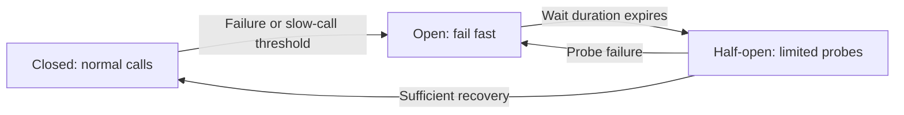
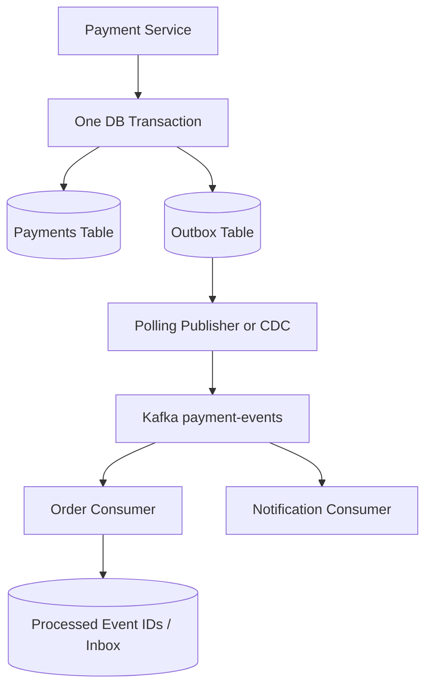
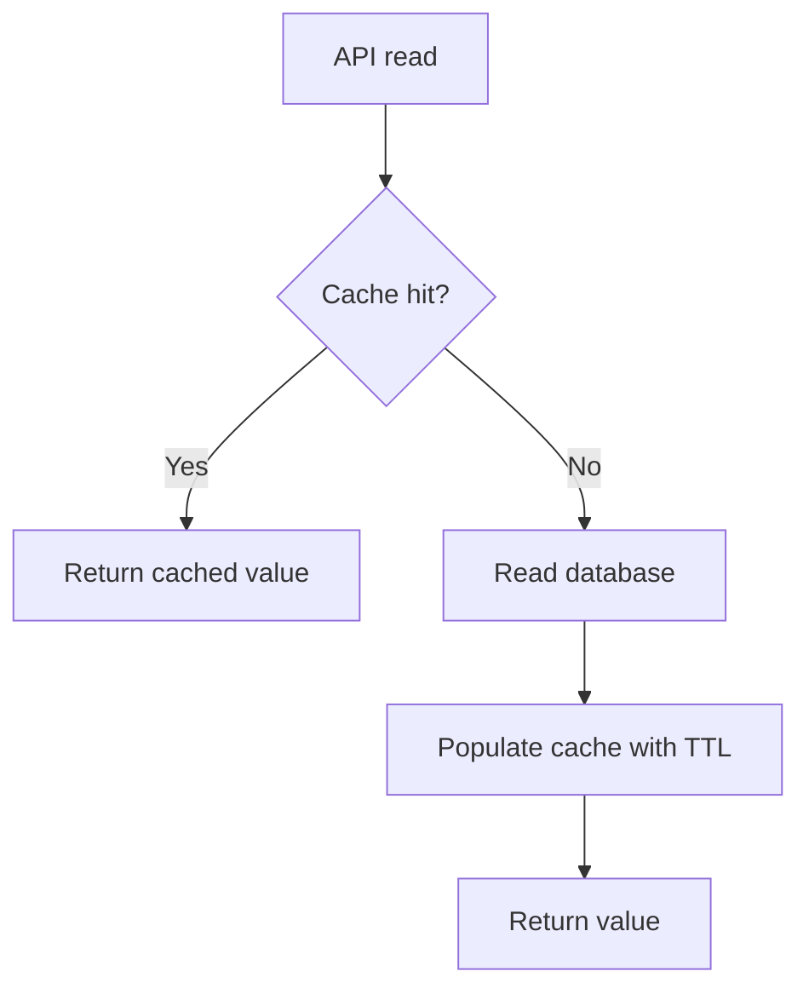
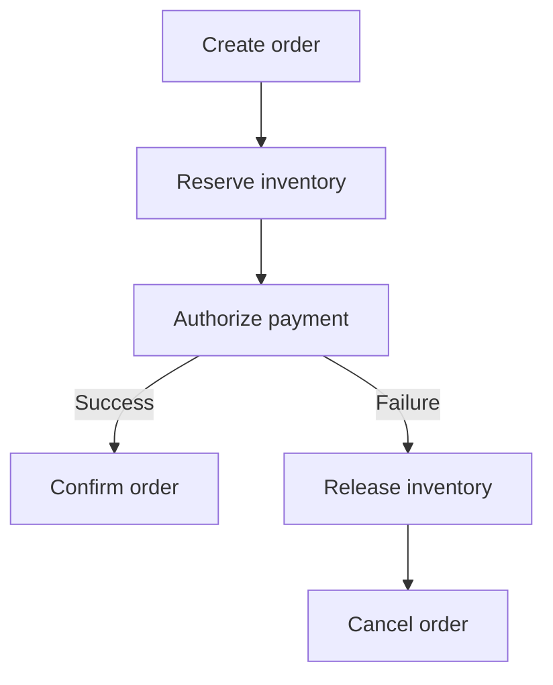
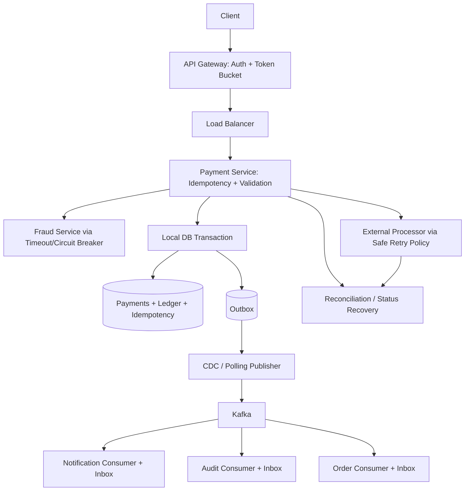

# System Design Patterns, Algorithms & Production Trade-offs

**Senior Software Engineer Interview Handbook**  
**Focus:** Java/Spring Boot, Kafka, Redis, relational databases, payment and high-scale backend systems  
**Updated:** November 2026

> **How to use this handbook:** For every pattern, learn the **situation → problem → mechanism → example → failure modes → trade-offs → alternatives → interview decision**. No technique is universally best. State assumptions and business requirements before choosing.

## Contents

1. [System-design decision framework](#1-system-design-decision-framework)
2. [Rate limiting](#2-rate-limiting)
3. [Load balancing](#3-load-balancing)
4. [Circuit breakers, timeouts, retries, and bulkheads](#4-circuit-breakers-timeouts-retries-and-bulkheads)
5. [Backpressure, queues, and load shedding](#5-backpressure-queues-and-load-shedding)
6. [Transactional Outbox, CDC, Inbox](#6-transactional-outbox-cdc-inbox)
7. [Kafka delivery guarantees and ordering](#7-kafka-delivery-guarantees-and-ordering)
8. [Caching read/write patterns](#8-caching-readwrite-patterns)
9. [Cache eviction and failure scenarios](#9-cache-eviction-and-failure-scenarios)
10. [Cache/database consistency](#10-cachedatabase-consistency)
11. [Database concurrency and isolation](#11-database-concurrency-and-isolation)
12. [Partitioning, sharding, replication, hashing](#12-partitioning-sharding-replication-hashing)
13. [Distributed transactions and Saga](#13-distributed-transactions-and-saga)
14. [Heaps, Top-K, scheduling](#14-heaps-top-k-scheduling)
15. [Distributed coordination](#15-distributed-coordination)
16. [Probabilistic data structures](#16-probabilistic-data-structures)
17. [Pagination, batching, and search](#17-pagination-batching-and-search)
18. [Capacity, availability, and observability](#18-capacity-availability-and-observability)
19. [End-to-end payment architecture](#19-end-to-end-payment-architecture)
20. [Interview cheat sheet and practice plan](#20-interview-cheat-sheet-and-practice-plan)

---

## 1. System-design decision framework

For each requirement ask:

- **Scale:** Average and peak requests/sec, data size, growth, read/write ratio, hotspots.
- **Latency:** p50/p95/p99 end-to-end deadlines and downstream budgets.
- **Correctness:** Can data be stale? Are duplicates, reordering, or partial results acceptable?
- **Availability:** Fail open or closed? Which operations must remain available during outages?
- **Durability:** When is a write acknowledged? What survives process, host, or region failure?
- **Operations:** How will we monitor, roll back, recover, and reconcile?

**Sample:** 2 million transactions/day averages ~23.1 TPS, but a 5,000 TPS peak is a very different sizing constraint. Always size for credible peaks, not averages alone.

| Symptom | First technique to consider | Important caveat |
|---|---|---|
| Excessive incoming traffic | Rate limiting | Does not fix insufficient sustained capacity |
| Uneven server utilization | Load balancing | Health and connection draining matter |
| Slow/unhealthy dependency | Timeout + circuit breaker | Payment failure policy must be explicit |
| Producer faster than consumer | Backpressure + bounded queues | Durable backlog can still grow |
| DB commit succeeds, event fails | Transactional Outbox | Consumer still needs deduplication |
| Frequent repeated reads | Cache Aside | Cache consistency and stampede |
| Concurrent balance modifications | Atomic update / locking | Ledger and idempotency still needed |
| Cross-service transaction | Saga / TCC | Compensation is not always a rollback |
| Data too large for one server | Sharding | Cross-shard queries and rebalancing |

## 2. Rate limiting

### Situation and problem

A payment API handles 1,000 requests/sec normally. A buggy client sends 50,000 requests/sec, exhausting application threads and DB connections. We need admission control per user, API key, tenant, IP, or globally.

### Placement

```text
Client → CDN/WAF → API Gateway [auth + rate limiter] → Load Balancer → Service
                           ↘ Redis/shared counters
```

A gateway limiter is not a substitute for service-level concurrency controls. Distributed limiters need atomic shared state; independent in-memory counters only enforce per-instance limits.

### Algorithms

| Algorithm | Mechanism | Time / memory per key | Strength | Weakness / best use |
|---|---|---|---|---|
| Fixed Window | Count requests in fixed interval | O(1) / O(1) | Simple | Boundary burst; coarse quotas |
| Sliding Window Log | Store timestamps, remove expired entries | Usually O(log n) updates / O(n) | Exact rolling limit | High memory for high-volume clients |
| Sliding Window Counter | Weight previous/current bucket counts | O(1) / O(1) | Cheap rolling estimate | Approximate |
| Token Bucket | Refill tokens at fixed rate, spend per request | O(1) / O(1) | Allows controlled bursts | Burst can stress backend |
| Leaky Bucket (queue model) | Drain bounded queue at steady rate | O(1) bookkeeping / queue size | Smooth output | Adds queue latency, rejects overflow |

**Fixed-window boundary example:** limit 100/min; 100 at 10:00:59 and 100 at 10:01:00 may pass within ~1 second.

**Sliding-window log example:** limit 3 in any rolling 60 sec; at 10:01:05 timestamps 10:00:15, 10:00:35, 10:00:55 are still active, so the next request is rejected.

**Sliding counter example:** previous bucket 80, current bucket 30, previous overlap 25%; estimated rolling count = `30 + 0.25 × 80 = 50`.

**Token Bucket example:** capacity 10, refill 2 tokens/sec. A full bucket permits an immediate burst of 10; long-run admitted average is about 2/sec (subject to refill and arrival timing).

```text
tokens = min(capacity, tokens + elapsed_seconds * refill_per_second)
if tokens >= request_cost:
    tokens -= request_cost
    ALLOW
else:
    REJECT (HTTP 429; optionally Retry-After)
```

**Implementation:** Use a Redis Lua script or another atomic operation to update token count and last-refill time together. Account for clock consistency, key expiry, tenant cardinality, and Redis outage policy.

**Trade-offs / alternatives:** Token Bucket is a strong general API default; Sliding Window Log for strict rolling quotas; queue-based Leaky Bucket for smoothing; concurrency limiters for in-flight work. Use layered limits (per user, per tenant, global). Decide fail-open vs fail-closed explicitly, particularly for authentication and financial operations.

**Interview follow-up:** What happens when Redis fails? Explain local emergency limits, bounded fallback, reduced service, or fail-closed behavior based on risk.

## 3. Load balancing

### Situation and problem

Three servers have different CPU capacities and different request durations. Naive routing overloads one while others sit idle.

```text
Clients → L7/L4 Load Balancer → A (healthy)
                             → B (healthy)
                             → C (unhealthy: removed)
```

### Algorithms

| Algorithm | Decision | Good for | Caveat |
|---|---|---|---|
| Round Robin | Rotate A→B→C | Similar servers, uniform requests | Ignores cost/load |
| Weighted Round Robin | Allocate proportional to weight | Unequal server capacities | Static weights may become stale |
| Least Connections | Fewest open connections | Long-lived connections | Connection count ≠ CPU work |
| Least Requests | Fewest in-flight requests | Variable HTTP request time | Needs load feedback |
| Power of Two Choices | Sample 2, pick less loaded | Large fleets | Approximate global optimum |
| EWMA Latency | Prefer lower smoothed latency | Latency-sensitive traffic | Can create feedback/hotspots |
| IP/Key Hash | Stable affinity | Stateful routing | Skew and remapping |
| Consistent/Rendezvous Hash | Stable key→node ownership | Cache/shard affinity | Membership and skew management |

**Example:** A has 8 cores, B 4, C 2. Weighted RR with weights 4:2:1 sends roughly 4/7, 2/7, 1/7 of selections to A/B/C.

**Best starting point:** For stateless APIs use RR or Least Requests plus health checks, connection draining, multi-AZ routing, and observability. For key affinity use consistent hashing; do not depend on sticky sessions if stateless auth is feasible.

**L4 vs L7:** L4 routes TCP/UDP connections based on transport information; L7 understands HTTP routes/headers and can implement richer policies at higher processing cost.

## 4. Circuit breakers, timeouts, retries, and bulkheads

### Situation and problem

Payment Service calls Fraud Service (normally 50 ms). Fraud slows to 5 seconds. Threads and connection pools fill, creating cascading failures.

```text
Payment → [Timeout + Bulkhead + Circuit Breaker] → Fraud
                        |
                  Fail fast / policy
```

### Circuit breaker state machine



- **Closed:** Track failure rate and slow calls in a count/time sliding window.
- **Open:** Reject calls without contacting dependency.
- **Half-open:** Permit limited probes; close on sufficient success, reopen on failure.
- **Example:** Open when failure rate ≥50% after at least 100 calls; wait 30 sec; allow 10 probes. Thresholds are illustrative, not universal.

### Complementary techniques

| Technique | Solves | Example / caveat |
|---|---|---|
| Timeout | Unbounded waiting | Set 300 ms per-call budget; consider end-to-end deadline |
| Bounded retry | Transient failures | Only retry safe/idempotent operations |
| Exponential backoff | Retry amplification | 100, 200, 400, 800 ms capped |
| Full jitter | Synchronized retries | Random delay in `[0, capped_backoff]` |
| Retry budget | Retry storms | Cap retries relative to original traffic |
| Bulkhead | Shared pool exhaustion | Fraud max 20 concurrent, Rewards max 10 |
| Load shedding | Server overload | Reject low-priority traffic early |
| Hedged requests | Tail latency | Duplicate delayed reads only when safe and budgeted |

**Key trade-off:** A circuit breaker improves caller stability but can reject calls during partial recovery. Retries increase load and latency; excessive retries at every layer multiply requests. Prefer retries at a controlled layer with an overall deadline.

**Payment-specific caution:** A timeout does **not** mean the processor did not execute a charge. Query transaction status or reconcile before retrying. Fraud checks may need fail-closed rather than a permissive fallback.

## 5. Backpressure, queues, and load shedding

### Situation and problem

Producer publishes 10,000 events/sec; consumer handles 2,000/sec. Backlog grows 8,000/sec, or 480,000 in one minute.

```text
Producer 10k/s → Kafka durable backlog → Consumer 2k/s
                                           ↘ bounded worker queue
```

### Techniques

| Technique | Mechanism | Use / risk |
|---|---|---|
| Bounded queue | Cap waiting items | Prevent OOM; may reject/block |
| Blocking | Wait for capacity | Can tie up producer threads |
| Drop newest | Reject new item | Only for loss-tolerant data |
| Drop oldest | Prefer fresh updates | Never silently drop financial transactions |
| Demand signaling | Subscriber requests N items | Reactive Streams |
| Pause/resume | Kafka consumer stops fetching selected partitions | Lag continues to accumulate |
| Batch processing | Amortize I/O | Increased batch latency and failure scope |
| Autoscaling | Add workers | Limited by partitions, DB, external quotas |
| Load shedding | Reject at admission | Protects latency and availability |

**Java bounded queue:**

```java
BlockingQueue<PaymentEvent> queue = new ArrayBlockingQueue<>(1000);
boolean accepted = queue.offer(event); // false when full
```

**Reactive Streams:** `subscription.request(10)` requests 10 more items; Reactor `limitRate(10)` manages upstream demand, **not** 10 requests/second.

**Kafka considerations:** `pause()`/`resume()` control fetching, not broker retention or producer rate. Continue polling appropriately, monitor lag and `max.poll.interval.ms`, use bounded workers, retry topics/DLQ for poison messages, and keep acknowledgments aligned with durable processing.

**Trade-off:** A bounded queue converts runaway memory growth into explicit waiting or rejection. The long-term fix may require reducing incoming load or increasing processing capacity.

## 6. Transactional Outbox, CDC, Inbox

### Situation and problem: dual write

```java
paymentRepository.save(payment); // DB commit succeeds
kafkaTemplate.send("payment-events", event); // Kafka fails
```

Database says `SUCCESS`; consumers never learn about it. Two independent systems cannot be atomically committed by a normal local DB transaction.

### Transactional Outbox solution



**Steps:**

1. Receive payment with idempotency key.
2. Within **one database transaction**, update payment state and insert an outbox event.
3. Commit both or roll back both.
4. Poller or CDC connector publishes committed event to Kafka.
5. Consumers process idempotently and commit offsets after durable business updates.

```sql
BEGIN;
UPDATE payments SET status = 'SUCCESS' WHERE payment_id = 'PAY-1001';
INSERT INTO outbox_events(event_id, aggregate_id, event_type, status)
VALUES ('EVT-101', 'PAY-1001', 'PaymentCompleted', 'PENDING');
COMMIT;
```

### Polling vs CDC

| Approach | Mechanism | Strength | Trade-off |
|---|---|---|---|
| Polling publisher | Scan pending outbox rows | Easy to understand/deploy | Query load, polling delay, claim/recovery logic |
| CDC (e.g., Debezium) | Read committed DB log changes | Low latency, less scanning | Connector, log retention, replication slot operations |

**Multi-publisher polling:** PostgreSQL `SELECT ... FOR UPDATE SKIP LOCKED` can coordinate claims, but do not hold DB locks over slow Kafka network operations; use explicit claiming/leases/recovery and durable publish acknowledgment.

### Why duplicate events are still possible

```text
Publish to Kafka succeeds → publisher crashes before marking PUBLISHED
→ restart → same event published again
```

**Solution:** Idempotent Consumer / Inbox. In one transaction insert `(consumer_name, event_id)` with a unique constraint and perform the business mutation only if insertion succeeded. Commit Kafka offset after the DB commit.

**Guarantee:** Outbox gives atomic *local DB state + event intent* and usually at-least-once event delivery. It does not magically provide exactly-once end-to-end external side effects.

**Alternatives:** CDC from business tables (harder to express intent), direct publish with reconciliation (less reliable), Kafka transactions (do not atomically include an arbitrary external database), 2PC only when supported and justified.

## 7. Kafka delivery guarantees and ordering

### Delivery semantics

- **At-most-once:** May lose messages, avoids redelivery; e.g., commit offset before processing.
- **At-least-once:** Retry until acknowledged; duplicates possible. Common durable choice.
- **Exactly-once scope:** Kafka transactions and idempotent producers can support specific Kafka-to-Kafka guarantees; external DB/API side effects still require idempotency or coordination.

### Ordering

Kafka orders records **within a partition**, not across a whole topic.

```text
payment-events
  Partition 0 (key PAY-101): CREATED → AUTHORIZED → CAPTURED
  Partition 1 (key PAY-202): CREATED → FAILED
```

Use a stable entity key (`paymentId`) and version/sequence number. Increasing partitions can change key-to-partition mapping; application concurrency and retries can reorder downstream effects.

### Failure patterns and solutions

| Failure | Solution |
|---|---|
| Consumer crashes after DB commit, before offset commit | Idempotent processing |
| Poison message repeatedly fails | Bounded retries + DLQ + alerting |
| Duplicate publish | Stable event ID and dedupe |
| Out-of-order update | Version check / sequence validation |
| Hot partition | Choose balanced partition key; consider business ordering needs |
| High lag | Scale consumers, optimize work, adjust partition count carefully |

**Interview answer:** Kafka is durable asynchronous transport, not a replacement for business transaction semantics.

## 8. Caching read/write patterns

### Situation and problem

A product API repeatedly reads unchanged records; DB reads become expensive and slow. Redis can absorb repeated lookups.

### Cache Aside (lazy loading)



**Example:** `GET /products/P-101` checks Redis, on miss reads PostgreSQL and stores result for 300 seconds.

### Strategies compared

| Strategy | Read flow | Write flow | Strength | Weakness |
|---|---|---|---|---|
| Cache Aside | App checks cache then DB | DB write + invalidate/update cache | Flexible, stores hot data | Miss latency and stale races |
| Read Through | Cache layer loads on miss | Separate policy | Simpler app reads | Requires cache loader support |
| Write Through | Reads from cache | Coordinated cache + DB update | Timely cache update | Write latency, partial failure |
| Write Behind/Back | Reads from cache | Buffer first, DB later | High write throughput | Durability/replay/ordering risks |
| Refresh Ahead | Serve cached | Proactively refresh hot keys | Fewer misses | Background refresh cost |

**Recommended:** Cache Aside for read-heavy catalog/profile data; DB as source of truth for payment balances. Write-behind requires a **durable** log/queue before acknowledging critical writes.

## 9. Cache eviction and failure scenarios

### Eviction algorithms

| Algorithm | Removes | Best for | Weakness |
|---|---|---|---|
| LRU | Least recently accessed | Temporal locality | Scans pollute cache |
| LFU | Least frequently accessed | Stable popularity | Old hot items can linger |
| FIFO | Earliest inserted | Simplicity | Ignores recency/frequency |
| TTL | Expired entries | Data lifetime bound | Not always primary memory eviction policy |
| W-TinyLFU | Uses approximate frequency for admission | General-purpose in-memory caching | More complexity |

**LRU walkthrough, capacity 3:**

```text
PUT A → [A]
PUT B → [A,B]
PUT C → [A,B,C]
GET A → [B,C,A]    (A becomes most recent)
PUT D → [C,A,D]    (evict B)
GET B → MISS
```

**LRU implementation:** HashMap + doubly linked list gives O(1) average get/put/evict. LFU often uses frequency buckets with O(1) average operations in more complex implementations.

### Cache stampede (thundering herd)

**Situation:** Hot key expires; 10,000 concurrent requests all miss and query DB.

**Solutions:** Single-flight/request coalescing; short distributed refresh lock; stale-while-revalidate if stale values are acceptable; refresh-ahead; randomized TTL.

**Trade-off:** Stale-while-revalidate improves availability but is wrong for strict balances/inventory guarantees.

### Cache penetration

**Situation:** Repeated reads of nonexistent product IDs always miss.

**Solutions:** Negative caching with short TTL, input validation, Bloom Filter, rate limiting. Bloom Filter false positives are possible; false negatives should not occur for correctly inserted, maintained items.

### Cache avalanche

**Situation:** Many keys expire simultaneously; DB overload.

**Solutions:** TTL jitter, staggered refresh, warming, load shedding, capacity headroom.

### Hot key

**Situation:** One celebrity profile gets 100k requests/sec.

**Solutions:** Local near-cache, replicated reads, CDN for public data, request coalescing. Keep invalidation and consistency in mind.

## 10. Cache/database consistency

### Race: invalidate after DB commit is not sufficient in all cases

```text
T1 Reader: cache MISS
T2 Reader: DB returns old price $100
T3 Writer: DB commits new price $120
T4 Writer: deletes cache key
T5 Reader: writes stale $100 to cache
Result: DB=$120, cache=$100
```

### Techniques

1. **DB-first, post-commit invalidation:** Common default, but invalidation failure/races remain.
2. **TTL:** Bounds staleness duration; not a correctness guarantee.
3. **Versioned values / compare-and-set:** Reject writes with versions older than the latest known version; coordinate atomicity.
4. **Outbox + CDC invalidation:** Reliably propagate committed changes; still plan for delays and ordering.
5. **Read-after-write from primary:** Stronger correctness for critical operations.
6. **Delayed double delete:** Mitigation only; timing does not guarantee correctness.

**Example choice:** Product prices can often use Cache Aside + post-commit invalidation + TTL. Account balance and ledger writes should use the authoritative DB/ledger and transactional controls; only cache for explicitly stale-tolerant use cases.

**Alternatives:** Write-through, event-driven cache updates, versioned cache keys, immutable snapshot keys, no cache.

## 11. Database concurrency and isolation

### Lost update

Account starts at $1,000. A withdraws $300 and B withdraws $400. Both read $1,000; naive writes may leave $600 or $700 instead of $300.

### Solutions

**Atomic conditional update:**

```sql
UPDATE accounts
SET balance = balance - 300
WHERE account_id = 101 AND balance >= 300;
-- Check exactly one row affected
```

**Optimistic locking:**

```sql
UPDATE accounts
SET balance = 700, version = version + 1
WHERE account_id = 101 AND version = 5;
-- 0 updated rows means conflict; retry/reject
```

**Pessimistic locking:**

```sql
BEGIN;
SELECT balance FROM accounts WHERE account_id = 101 FOR UPDATE;
-- validate and update
COMMIT;
```

| Technique | Strength | Trade-off / use |
|---|---|---|
| Atomic SQL | Simple and safe for local conditional changes | Limited to expressible invariants |
| Optimistic locking | High throughput at low contention | Conflict retries |
| Pessimistic locking | Serializes contended writes | Blocking/deadlocks |
| MVCC | Concurrent snapshots/versions | Isolation anomalies depend on level |
| Serializable isolation | Strong transaction guarantees | Aborts/retries and overhead |

**Isolation:** Understand dirty reads, non-repeatable reads, phantoms, lost updates, write skew, and how actual database implementations differ. MVCC does not automatically guarantee serializability.

**Financial design note:** A mutable balance field is not a complete ledger. Consider immutable double-entry journal records, reconciliation, auditability, and idempotency.

## 12. Partitioning, sharding, replication, hashing

### Definitions

- **Partitioning:** Split one logical table into physical partitions (e.g., monthly payment partitions) within a database system.
- **Sharding:** Distribute data across separate database servers/clusters.
- **Replication:** Maintain copies for resilience and potentially read scaling.

```text
Logical Payments Table
 ├─ 2026-01 partition
 ├─ 2026-02 partition
 └─ 2026-03 partition

Shard Router
 ├─ Shard 0: customer IDs 0–999
 ├─ Shard 1: customer IDs 1000–1999
 └─ Shard 2: customer IDs 2000–2999
```

### Shard placement

| Method | Example | Advantage | Problem |
|---|---|---|---|
| Modulo hash | `hash(customerId) % N` | Simple, balanced if hash is good | Adding shard remaps many keys |
| Range | ID 0–999 on shard 0 | Range scans | Hot newest range |
| Directory lookup | `customerId → shardId` | Flexible migration | Metadata availability/lookup |
| Consistent hash | Key to next clockwise node | Less remapping | Virtual nodes, membership complexity |
| Rendezvous hash | Score nodes for each key | Stable mapping | Naive O(number of nodes) scoring |

**Consistent hashing:** Hash keys and nodes to a ring; assign a key to the next clockwise node. Adding a node moves only keys in its newly owned region (in the standard model). Virtual nodes improve balance. Use replication and recovery for node failures.

**Replication trade-offs:** Async replicas may be stale; sync replication increases write latency. Distinguish availability, durability, read-your-writes, and failover data loss (RPO/RTO).

**Shard challenges:** Hot partitions, cross-shard joins, distributed transactions, resharding, secondary indexes, and tenant isolation.

## 13. Distributed transactions and Saga

### Situation

Checkout spans Order, Inventory, Payment, Shipping services, each with its own database. Payment fails after inventory is reserved.

### Saga orchestration



**Choreography:** Services react to events; loose coupling but hard to follow complex workflows. **Orchestration:** Central durable workflow state directs steps; easier visibility but more coordinator responsibility.

### Alternatives

| Pattern | How | Good for | Trade-off |
|---|---|---|---|
| Saga | Local transactions + compensations | Long-running microservice workflows | Temporary inconsistency, compensation failure |
| TCC | Try/Reserve, Confirm, Cancel | Services supporting reservations | Requires reservation APIs and expiration |
| 2PC | Prepare then commit/abort | Compatible transactional participants | Blocking, availability, complexity |

**Caution:** A refund is not equivalent to undoing a charge; it is a new business action. Compensation must be idempotent, retryable, observable, and reconcilable.

## 14. Heaps, Top-K, scheduling

### Heap fundamentals

- **Min heap:** smallest item at root.
- **Max heap:** largest item at root.
- `peek`: O(1); insert/remove root: O(log n); build heap: O(n); arbitrary search: O(n).

### Top-K largest transaction amounts

Input `[100,500,200,900,300,700]`, K=3. Maintain a **min heap of size 3**.

```text
100 → [100]
500 → [100,500]
200 → [100,200,500]
900 → remove 100; keep [200,500,900]
300 → remove 200; keep [300,500,900]
700 → remove 300; keep [500,700,900]
```

(Shown sorted for readability, not the internal heap array order.) **Time:** O(n log K), **space:** O(K).

**Java 8:**

```java
PriorityQueue<Integer> minHeap = new PriorityQueue<>();
for (int x : values) {
    if (minHeap.size() < k) minHeap.offer(x);
    else if (x > minHeap.peek()) {
        minHeap.poll();
        minHeap.offer(x);
    }
}
```

### System-design uses

| Problem | Technique | Why |
|---|---|---|
| Top 100 trending posts | Min heap size 100 | Keep largest K scores |
| Next job to execute | Min heap by due time | Earliest deadline at root |
| Merge K sorted logs | Min heap across K heads | O(N log K) merge |
| Streaming median | Max heap lower half + min heap upper half | Efficient median updates |
| Dijkstra shortest path | Min priority queue by distance | Next smallest tentative distance |
| K nearest candidates | Max heap size K | Evict farthest among retained |

**Trade-offs:** Heap excels at top-priority access, not arbitrary lookups or ordered iteration. For distributed Top-K, compute local candidates and merge; approximate heavy-hitter algorithms may help at enormous scale.

## 15. Distributed coordination

### Leader election and leases

**Problem:** Two scheduler instances both run the same exclusive job. Use a coordination service/lease to elect a leader. But a paused leader can resume after its lease expires.

**Fencing tokens:** Monotonically increasing generations, e.g., old leader token 41, new leader token 42. Protected storage must reject writes from token 41 after observing 42. A lease alone is insufficient if stale owners can still act.

### Distributed locking alternatives

| Technique | Strength | Caveat |
|---|---|---|
| DB row lock | Strong within one DB transaction | Not for long remote work |
| Redis lease | Fast coordination | Expiry, pauses, fencing concerns |
| ZooKeeper/etcd coordination | Consistent membership/leases | Operational overhead |
| Idempotent task claims | Safe duplicate execution | Often simpler than global locks |

**Job scheduler:** Durable task store + atomic claim + worker heartbeat/lease + fencing or idempotent completion + retries + dead-letter handling. For DAG dependencies, use topological order (Kahn's algorithm); a priority queue chooses ready tasks by policy.

## 16. Probabilistic data structures

| Structure | Problem | How it works | Limitation |
|---|---|---|---|
| Bloom Filter | Approximate membership | Bit array + multiple hashes | False positives; deletion tricky |
| HyperLogLog | Approximate distinct count | Compact hashed cardinality sketch | Approximate only |
| Count-Min Sketch | Approximate frequencies | Multiple hash rows/counters | Collision overestimation |

**Examples:** Bloom Filter for “might product ID exist?”; HyperLogLog for unique daily visitors; Count-Min Sketch for identifying hot keys. These save memory at the cost of controlled estimation error.

## 17. Pagination, batching, and search

### Offset vs cursor pagination

**Offset:** `LIMIT 20 OFFSET 100000` is simple but can become expensive and unstable when records change.

**Keyset/cursor:** Query rows after a stable `(created_at, id)` pair:

```sql
SELECT * FROM posts
WHERE (created_at, id) < (:cursor_time, :cursor_id)
ORDER BY created_at DESC, id DESC
LIMIT 20;
```

Use matching indexes. Cursor pagination is usually better for deep scrolling, but arbitrary jumping to page 500 is harder.

### Batching

Batch inserts/reads reduce network round trips but may increase per-batch latency, lock duration, and retry scope. Choose batch sizes by benchmarking, not intuition.

### Search/feed ranking

Inverted indexes map terms to document IDs. Feed generation can use fan-out-on-write for normal users and fan-out-on-read for very high-follower accounts; Top-K heaps merge ranked candidates. Trade-offs include write amplification, read latency, freshness, and hot keys.

## 18. Capacity, availability, and observability

### Little's Law

`L = λ × W`, where L is average in-flight/waiting requests, λ arrival rate, W average time in system.

**Example:** 2,000 requests/sec × 0.2 sec = **400 average concurrent requests** inside the measured boundary. This is not necessarily 400 threads in an async service.

### Capacity checklist

- Average and peak QPS/TPS; burst factor.
- p95/p99 latency and timeout budgets.
- Read/write mix, DB connections, cache hit rate.
- Storage growth, index size, retention, compaction.
- Kafka partitions, consumer lag, event size, throughput.
- Network bandwidth, CPU, memory, GC, thread pool sizing.
- Multi-AZ/multi-region replication and failover testing.

### Availability / recovery

- **RPO:** Maximum tolerable data loss.
- **RTO:** Maximum acceptable recovery time.
- **Multi-AZ:** Protect against zone failures.
- **Multi-region:** Higher resilience and latency/cost/consistency complexity.
- **Health checks:** Readiness (can serve) vs liveness (should restart).
- **Graceful degradation:** Keep critical flows available, shed noncritical work.

### Observability

- **RED:** Request rate, error rate, duration.
- **USE:** Utilization, saturation, errors for resources.
- **Golden signals:** Latency, traffic, errors, saturation.
- **Distributed tracing:** Follow request across services; propagate trace IDs.
- **SLO/error budget:** Define measurable reliability goals and alert on meaningful burn rates.

**Track:** rate-limit rejection, circuit state, retry counts, pool saturation, queue depth, Kafka lag, outbox age, cache hit rate, stale-read rate, DB lock waits, p99 latency, payment reconciliation mismatches.

## 19. End-to-end payment architecture

### Interview requirements (illustrative)

- 2M payments/day average (~23 TPS), with burst peaks up to 5,000 TPS.
- Prevent duplicate execution for the same logical payment.
- Maintain authoritative payment/ledger state.
- Publish events reliably, tolerate consumer duplicates.
- Meet explicit latency, availability, and reconciliation targets.



### Walkthrough

1. Gateway authenticates, enforces rate limits and request size.
2. Load balancer routes to healthy payment instances.
3. Service atomically claims idempotency key and validates request fingerprint.
4. Fraud and external payment calls have deadlines, circuit breakers, concurrency limits and business-safe retries.
5. External processor may have **unknown** outcome on timeout; persist pending/unknown state and reconcile instead of assuming failure.
6. Commit authoritative payment/ledger state and outbox event in one DB transaction (for the local state transition).
7. CDC/poller publishes to Kafka; at-least-once publication is acceptable.
8. Consumers dedupe by event ID and apply business updates transactionally.
9. Observe outbox age, consumer lag, duplicate counts, p99 latency, and reconciliation backlog.
10. Multi-AZ replication, backups, and runbooks protect recovery objectives.

### Failure matrix

| Failure | Expected behavior |
|---|---|
| Duplicate client request | Same idempotency key returns stored result/state |
| Fraud dependency slow | Timeout + circuit; follow explicit risk policy |
| Processor times out after possible charge | Status query/reconciliation, not blind duplicate charge |
| DB transaction fails | No local payment/outbox commit |
| Kafka unavailable | Outbox persists intent, publisher retries |
| Publisher crashes after Kafka ack | Duplicate possible; consumers dedupe |
| Consumer fails mid-processing | Retry after restart; idempotent update |
| Cache stale | Authoritative DB/ledger used for correctness |
| Sudden burst | Gateway rate limit + bounded concurrency/load shedding |

### Interview trade-off statement

> “I prioritize financial correctness over a slightly faster response. I keep the database/ledger authoritative, make external calls idempotent where supported, use a transactional outbox for event intent, and reconcile uncertain outcomes. I protect dependencies with deadlines, circuit breakers and bulkheads, and use caching only where staleness is acceptable.”

## 20. Interview cheat sheet and practice plan

### Technique selection

| Interview symptom | Starting answer | Alternative / nuance |
|---|---|---|
| API spikes | Token Bucket | Sliding log for strict window |
| Slow dependency | Timeout + circuit breaker | Bulkhead, retry budget |
| Consumer overload | Bounded queue + backpressure | Scale, batch, shed optional work |
| DB/Kafka dual-write | Transactional Outbox | CDC/poller + Inbox |
| Duplicate payment | Idempotency key | Unique constraint, reconciliation |
| Duplicate Kafka event | Idempotent consumer | Inbox table, version check |
| Hot cache expiration | Single-flight | Stale-while-revalidate, jitter |
| Limited cache memory | LRU / W-TinyLFU | LFU for stable frequency |
| Stale cache after write | Invalidate + versioning | CDC invalidation, direct DB read |
| Concurrent updates | Atomic SQL / optimistic lock | Pessimistic lock if high contention |
| Multi-service workflow | Saga orchestration | TCC / 2PC in special cases |
| Shard redistribution | Consistent hashing | Rendezvous hashing |
| Trending Top-K | Min heap size K | Distributed Top-K merge |
| Duplicate scheduler owner | Lease + fencing token | Idempotent job claim |
| Approximate membership | Bloom Filter | Exact hash set if memory allows |

### Five-part interview answer template

1. **Situation:** “Our API gets bursts of 20k RPS against 5k safe capacity.”
2. **Problem:** “Queue growth causes high p99 latency and timeouts.”
3. **Solution:** “Apply Token Bucket at the gateway and bounded concurrency at the service.”
4. **Mechanism:** “Tokens refill at configured rate; admission consumes tokens; overflow gets 429.”
5. **Trade-offs:** “Burst capacity, Redis availability, tenant fairness, fail-open/closed, metrics and load testing.”

### 15-day study sequence

| Days | Focus | Practice |
|---|---|---|
| 1–3 | Rate limiting, LB, circuit breaker, retry, bulkhead, backpressure | Distributed rate limiter |
| 4–6 | Cache patterns, eviction, stampede, DB locking, sharding | Read-heavy product API |
| 7–9 | Kafka, idempotency, Outbox, Inbox, Saga, reconciliation | Payment system |
| 10–12 | Hashing, heaps, leader election, fencing, sketches | Distributed scheduler + Top-K feed |
| 13–15 | Capacity, multi-region, SLOs, full mock interviews | Payment, notification, news feed |

### Final checklist

- [ ] Explain why each component exists, not just its name.
- [ ] Quantify scale, latency, and availability assumptions.
- [ ] Explain normal flow and at least three failure flows.
- [ ] State whether duplicates, reordering, and stale reads are acceptable.
- [ ] Clarify transaction boundaries and durable acknowledgments.
- [ ] Discuss monitoring, recovery, and operational trade-offs.
- [ ] Compare at least one viable alternative.
- [ ] Explain the simplest architecture that meets the requirements before adding complexity.

---

**Further study topics:** Adaptive concurrency limits, admission control and queueing theory, read replicas and consistency, change-data-capture operations, event sourcing vs Outbox, CQRS, multi-region conflict resolution, security/OAuth, and distributed scheduler fairness. These are extensions, not prerequisites for every design.
